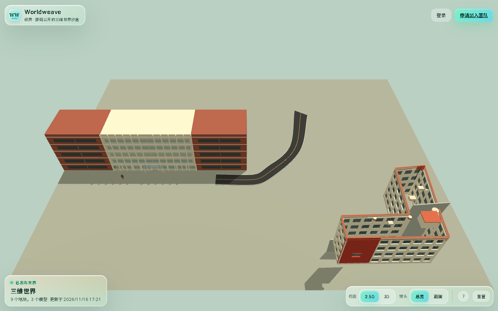
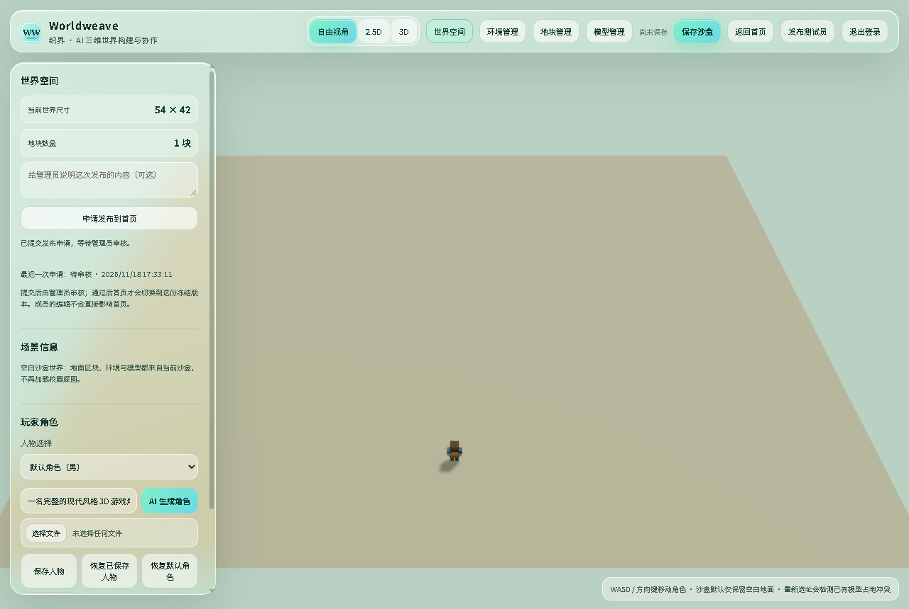
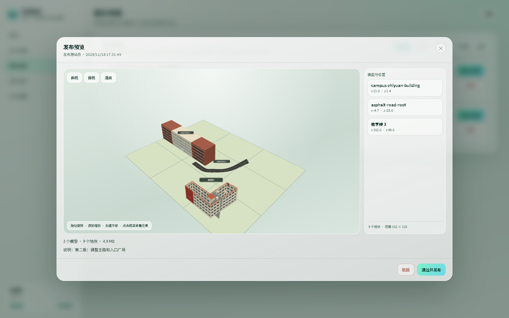
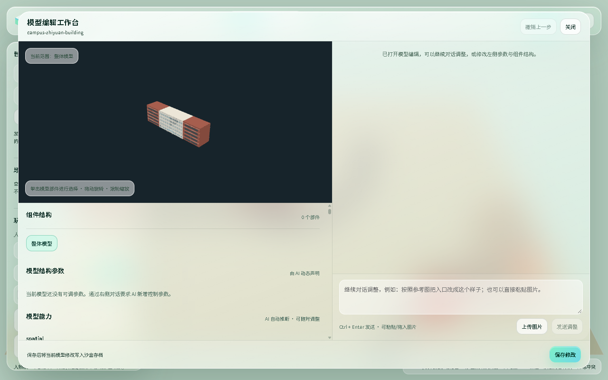
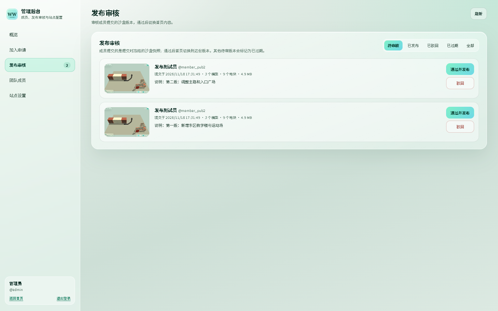
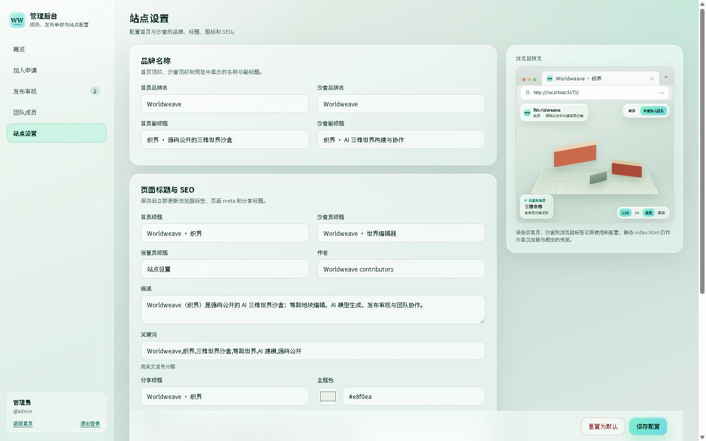
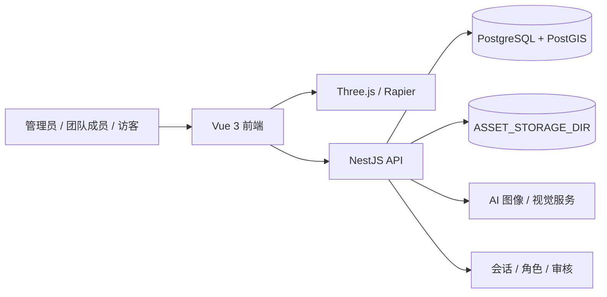
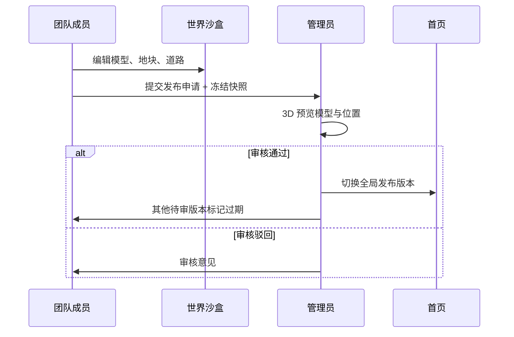

<p align="center"></p>

# Worldweave · 织界

<p>
  
  
  
  
  
  
  <a href="https://github.com/southyouth-team/worldweave/actions/workflows/frontend-ci.yml"></a>
  <a href="https://github.com/southyouth-team/worldweave/actions/workflows/backend-ci.yml"></a>
</p>

**源码公开的 AI 三维世界沙盒。**
Worldweave 把地块化 2.5D / 3D 世界编辑、AI 程序化模型生成、发布审核和团队协作放在同一个工作台里。校园只是内置示例场景——它同样可以用于园区、展场、乐园或任何等距世界。

> Source-available AI-assisted isometric world sandbox. Campus is a demo, not a limit.

> 本项目使用 **CC BY-NC-SA 4.0**：允许非商业使用、修改和分发，要求署名并以相同协议共享；禁止商业用途。它不是 OSI 认证的开源许可证。商业使用需单独授权。

## 界面预览

| 首页 | 世界沙盒 |
| --- | --- |
|  |  |
| 只渲染管理员审核通过的世界版本 | 地块、道路、模型与环境编辑 |

| 发布审核（3D 预览） | AI 模型工作台 |
| --- | --- |
|  |  |
| 直接查看提交快照中的模型和位置 | 对话式生成、部件选择与视觉质检 |

| 管理后台 | 站点设置 |
| --- | --- |
|  |  |
| 加入申请 / 发布审核 / 成员 / 设置 | 品牌、标题、SEO、logo 与浏览器预览 |

> 截图使用 demo 数据，仅用于展示界面。

## 目录

- [功能](#功能)
- [架构](#架构)
- [技术栈](#技术栈)
- [快速开始](#快速开始)
- [环境变量](#环境变量)
- [项目结构](#项目结构)
- [数据与存储](#数据与存储)
- [API 概览](#api-概览)
- [开发与测试](#开发与测试)
- [安全部署](#安全部署)
- [当前协作边界](#当前协作边界)
- [路线图](#路线图)
- [常见问题](#常见问题)
- [贡献与致谢](#贡献与致谢)
- [许可证](#许可证)

## 功能

### 世界编辑

- 2.5D 等距与 3D 透视双视图；总览、角色跟随、第一人称。
- 地块化世界：区块扩建/回收、边界、占地轮廓。
- 道路绘制、端点拉伸、断点拐弯、路口自然过渡、道路中心线。
- 模型放置、移动、旋转、缩放、复制、删除；碰撞与可通行性检查。
- 时间、天气、风、人工照明与天空运行时。

### AI 建模

- spec-first 分阶段生成：blockout → structure → material。
- 每阶段视觉质检；单张多视角对比表；失败自动重试。
- 修改前截图作为复检基线；修改/修复闭环。
- 部件选择与局部编辑；可编辑文字牌（`userData.textSpec`）。
- 角色生成同样进入工作台，支持应用到玩家。

### 发布与协作

- 成员提交发布申请：冻结快照 + 说明 + 720px 缩略图。
- 管理员在后台用 **3D 视图** 查看提交快照的模型、位置和地块范围。
- 通过后切换全局首页版本；旧的待审申请自动标记为过期。
- 驳回可填写原因，成员在沙盒中能看到审核意见。

### 账号与管理

- 管理员 / 团队成员两种角色；未登录只能浏览首页。
- 加入申请 → 管理员审核 → 自动创建账号 + 一次性临时密码。
- 首次登录强制改密；成员可自行改密。
- 成员启停用、角色调整、重置密码、登录失败限流。
- 管理员不进入模型编辑器，专注成员、发布审核与站点管理。

### 站点系统

- 品牌名、副标题、首页/沙盒/设置页标题。
- description / keywords / author / OG 信息、主题色。
- logo 上传与浏览器窗口实时预览。
- 首页、登录页、后台、沙盒共享同一份站点配置。

## 架构



发布审核流程：



## 技术栈

| 层 | 技术 |
| --- | --- |
| 前端 | Vue 3、Vite、Three.js、Rapier |
| 后端 | NestJS、TypeORM、PostgreSQL / PostGIS |
| 数据库 | 版本化 migration；角色、会话、申请、发布请求 |
| 存储 | 本地文件系统（可通过 `ASSET_STORAGE_DIR` 挂载持久卷） |
| AI | 兼容 OpenAI 风格的图像 / 视觉模型服务 |

## 快速开始

### 环境要求

- Node.js 20.19+（推荐 24 LTS）
- npm 10+
- PostgreSQL 16+，PostGIS 3.4+
- 可选：AI 图像/视觉模型服务

### 前端

```bash
npm install
npm run dev
```

打开 <http://localhost:5173/>。

### 后端

```bash
cd server
cp .env.example .env
# 修改 .env 中的数据库连接
npm install
npm run db:migrate
npm run start:dev
```

后端默认监听 <http://localhost:3001>，API 前缀 `/api/v1`，开发环境 Swagger 在 <http://localhost:3001/api/docs>。

开发环境首次启动会自动创建管理员 `admin / Admin@12345`，并强制首次登录改密。**生产环境必须设置 `ADMIN_USERNAME` / `ADMIN_PASSWORD`。**

### Docker Compose（推荐体验）

```bash
docker compose up --build
```

打开 <http://localhost:8080/>，默认管理员 `admin / Admin@12345`（可通过 `ADMIN_PASSWORD` 覆盖）。数据库和上传目录使用 Compose volumes 持久化。

> Compose 默认使用 `NODE_ENV=development` 以自动执行 migration 和创建初始管理员；正式部署请改为 production，并显式执行迁移、设置强密码和 `AUTH_ALLOW_DEV_HEADER=false`。

### 主要入口

| 地址 | 说明 |
| --- | --- |
| `/` | 首页：只渲染管理员审核通过的世界版本 |
| `/world-sandbox-mvp` | 世界沙盒编辑器（需登录） |
| `/admin` | 管理后台：加入申请、发布审核、成员、站点设置 |
| `/admin?view=settings` | 管理后台 · 站点设置 |
| `/join` | 申请加入团队 |
| `/login` | 登录 |

## 环境变量

完整配置见 `server/.env.example`。

| 变量 | 说明 |
| --- | --- |
| `NODE_ENV` | `development` / `production` |
| `PORT` / `API_PREFIX` | 后端端口与 API 前缀 |
| `CORS_ORIGIN` | 允许的前端来源，多个用逗号分隔 |
| `DB_HOST` / `DB_PORT` / `DB_USER` / `DB_PASSWORD` / `DB_NAME` | PostgreSQL 连接 |
| `DB_SSL` / `DB_LOGGING` | 数据库 SSL 与 SQL 日志 |
| `ASSET_STORAGE_DIR` | 上传、发布快照的持久化目录 |
| `ADMIN_USERNAME` / `ADMIN_PASSWORD` / `ADMIN_DISPLAY_NAME` | 初始管理员（生产必填） |
| `AUTH_ALLOW_DEV_HEADER` | 是否允许开发用 `X-Dev-User-Id` 兼容层；生产建议 `false` |
| `IMAGE_API_KEY` / `IMAGE_API_BASE_URL` / `IMAGE_MODEL` | AI 图像/模型生成服务 |
| `VISION_API_KEY` / `VISION_API_BASE_URL` | 视觉质检服务（未单独配置时复用图像配置） |
| `VITE_API_BASE_URL` | 前端访问的后端地址 |

## 项目结构

```text
src/
  App.vue                 首页、路由与全局壳
  components/
    WorldSandboxMvp.vue   世界沙盒编辑器
    ProceduralModelEditor.vue  AI 模型工作台
    AdminConsolePage.vue  管理后台（侧边菜单）
    SiteSettingsPage.vue  站点设置（可嵌入后台）
    SnapshotPreview3D.vue 发布快照 3D 预览
    Auth*.vue             登录 / 申请 / 改密
  three/                  场景引擎、相机、物理、程序化资产
  site/                   站点配置与文档 meta
  auth/                   会话与角色 API
  publish/                发布申请 API
server/
  src/modules/auth/       账号、会话、申请、成员
  src/modules/publish-requests/ 发布申请与审核
  src/modules/site-settings/    站点品牌配置
  src/modules/assets/     资产、底图、AI 生成
  src/database/migrations/
docs/                     架构、数据契约、历史规划与截图
public/                   favicon、manifest、静态数据
```

## 数据与存储

- `ASSET_STORAGE_DIR/homepage-snapshots/`：审核通过的全局首页快照（`__published__.json`）。
- `ASSET_STORAGE_DIR/publish-requests/`：成员提交的冻结快照文件。
- `ASSET_STORAGE_DIR/campus-*/`：底图、建筑模板、视觉资产与程序化资产。
- PostgreSQL：账号、会话、加入申请、发布请求、校园/地图/场景数据。
- 运行期上传和快照默认不进入 Git；生产环境请使用持久卷并定期备份。

## API 概览

| 方法 | 路径 | 说明 |
| --- | --- | --- |
| `POST` | `/api/v1/auth/login` | 用户名密码登录，写入 httpOnly 会话 Cookie |
| `POST` | `/api/v1/auth/logout` | 退出并销毁服务端会话 |
| `GET` | `/api/v1/auth/me` | 当前登录账号 |
| `POST` | `/api/v1/auth/change-password` | 修改密码并注销其他会话 |
| `POST` | `/api/v1/auth/join-applications` | 提交加入申请（公开） |
| `GET` | `/api/v1/site-settings` | 读取全局站点配置（公开） |
| `PUT` / `DELETE` | `/api/v1/site-settings` | 保存 / 重置站点配置（管理员） |
| `POST` | `/api/v1/publish-requests` | 成员提交发布申请 |
| `GET` | `/api/v1/publish-requests/mine` | 自己的发布申请记录 |
| `GET` | `/api/v1/admin/publish-requests` | 管理员查看发布申请 |
| `GET` | `/api/v1/admin/publish-requests/:id/snapshot` | 管理员读取冻结快照 |
| `POST` | `/api/v1/admin/publish-requests/:id/approve` | 通过并写入首页 |
| `POST` | `/api/v1/admin/publish-requests/:id/reject` | 驳回发布申请 |
| `GET` | `/api/v1/published-homepage` | 公开读取当前首页版本 |
| `GET` | `/api/v1/admin/join-applications` | 管理员查看加入申请 |
| `POST` | `/api/v1/admin/join-applications/:id/approve` | 通过并创建成员账号 |
| `GET` / `PATCH` | `/api/v1/admin/users`、`/api/v1/admin/users/:id` | 成员列表与角色/状态管理 |
| `POST` | `/api/v1/admin/users/:id/reset-password` | 重置成员密码 |

## 开发与测试

```bash
# 前端
npm test
npm run build

# 后端
cd server
npm test
npm run build
```

后端测试使用 Jest，前端使用 Vitest；当前既有基线失败集中在 CharacterMotor / InputController / PhysicsRuntime / PlayerCharacterRuntime。

## 安全部署

- `NODE_ENV=production`
- 设置强随机 `ADMIN_PASSWORD`，首次登录立即改密
- `AUTH_ALLOW_DEV_HEADER=false`，关闭开发身份兼容层
- 严格配置 `CORS_ORIGIN`，使用 HTTPS
- `ASSET_STORAGE_DIR` 使用持久化卷并限制目录访问权限
- 数据库使用最小权限账号，定期备份
- 登录、加入申请与 AI 生成接口在反向代理层增加限流
- 不要把 `.env`、数据库导出、用户密码、上传快照或未授权的校园数据提交到仓库

详见 [SECURITY.md](SECURITY.md)。

## 当前协作边界

已经具备：账号/角色、加入申请审批、成员管理、发布申请与 3D 审核、站点设置。

仍在路线图中：**共享世界 + 区块锁/在线状态**、已发布模型对普通成员的服务端只读强制、审计日志、WebSocket 实时协作。当前成员的编辑保存在各自浏览器，发布审核提交的是提交时冻结的快照。

## 路线图

- 服务端共享工作区 + 区块锁（租约/心跳/管理员强制解锁）+ 在线成员状态
- 已发布实体对普通成员只读的服务端强制与审计日志
- 发布快照的只读沙盒预览与版本对比
- 学校统一身份认证（CAS / OAuth2 / OIDC）
- AI 生成队列、成本限额与更细的接口限流

## 常见问题

**这是 OSI 开源项目吗？**
不是。CC BY-NC-SA 4.0 禁止商业使用，因此本项目属于 **source-available / 源码公开**，不是 OSI 认证的开源许可证。

**可以商用吗？**
不可以直接商用；需要单独获得商业授权。依赖库仍遵循各自许可证。

**管理员为什么不能编辑模型？**
当前角色按职责拆分：管理员负责成员、发布审核和站点设置；团队成员负责世界编辑和提交发布申请。

**发布后首页没变化？**
发布需要管理员在「发布审核」中通过；通过后首页读取的是全局 `__published__` 快照。

**上传的文件在哪里？**
默认在 `server/uploads/`，可通过 `ASSET_STORAGE_DIR` 改为持久化目录；这些运行期文件默认不纳入 Git。

**如何新增一个校园或世界？**
使用世界沙盒编辑地块、道路和模型，然后提交发布申请；项目本身不绑定某一所学校。

## 贡献与致谢

欢迎提交 Issue 和 Pull Request；请先跑通前后端测试，不要提交密钥、`.env`、上传快照或未授权的校园数据。详见 [CONTRIBUTING.md](CONTRIBUTING.md)。

感谢 Vue、Three.js、NestJS、TypeORM、Rapier、polygon-clipping 以及所有开源依赖的作者。

[](https://star-history.com/#southyouth-team/worldweave&Date)

## 许可证

[Creative Commons Attribution-NonCommercial-ShareAlike 4.0 International](LICENSE) © 2026 Worldweave contributors

- 允许：非商业使用、修改、分发；必须署名，衍生作品需以相同协议共享。
- 禁止：任何商业用途；商业使用需要单独获得授权。
- 本项目属于 **source-available / 源码公开**，不是 OSI 认证的开源项目。
- Creative Commons 不建议将 CC 许可用于软件；本项目选择它是因为“禁止商用”优先。依赖库仍遵循各自许可证。
- 示例校园数据、校名与校徽不在授权范围内。

许可证全文：<https://creativecommons.org/licenses/by-nc-sa/4.0/legalcode>

## 示例数据与商标

南昌工学院相关的名称、校徽、平面图、扫描数据和演示模型仅用于展示与技术验证，**本项目不是学校官方项目**。代码许可证不授予这些商标、校名或数据的使用权；使用真实校园数据前请先取得授权，并在发布内容中注明来源。
